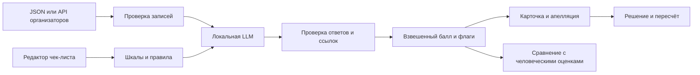

# Conversation Quality Analytics

Прототип для Freedom Broker Data Challenge. Загружает транскрипты RU, KZ и EN, проверяет работу оператора по редактируемому чек-листу, показывает основания оценки и сохраняет результат пересмотра. [Передача проекта и план работ](HANDOFF.md).

## Запуск

Требуются Python 3.10+ и локальная модель. У приложения нет зависимостей pip. Для стандартного запуска установите [Ollama](https://docs.ollama.com/windows), запустите его и выполните:

```powershell
ollama pull qwen3:4b
python app.py
```

Откройте http://127.0.0.1:8765. Три синтетических примера загружаются при первом запуске. Для оценки выберите диалог и нажмите **Оценить диалог**. Для других локальных моделей укажите `CQA_MODEL` до запуска приложения. Модель должна поддерживать JSON-вывод по схеме. [Документация Ollama](https://docs.ollama.com/capabilities/structured-outputs).

### Запуск с llama.cpp

Скачайте [Qwen3-4B-GGUF](https://huggingface.co/Qwen/Qwen3-4B-GGUF) (Q4_K_M). Запустите локальный [llama-server](https://github.com/ggml-org/llama.cpp/tree/master/tools/server) с включённым шаблоном чата:

```powershell
llama-server -m qwen3-4b-q4_k_m.gguf --alias qwen3:4b --host 127.0.0.1 --port 8080 -c 16384 -np 1 --jinja
```

Во втором терминале:

```powershell
$env:CQA_PROVIDER = "llamacpp"
python app.py
```

`CQA_OLLAMA_URL` и `CQA_LLAMA_URL` задают адрес соответствующего локального сервера. `CQA_TIMEOUT_SECONDS` задаёт время ожидания ответа модели в секундах (по умолчанию 240). Для длинных звонков на медленном компьютере увеличьте лимит, например `$env:CQA_TIMEOUT_SECONDS = "420"`, и измерьте время прогона. На машине с GPU можно задать параметры выгрузки слоёв в `llama-server` отдельно.

## DEV и контрольный набор

Скопируйте ссылку **Открыть GET для DEV** со стр. 3 гайда в локальный файл `data/dev-url.txt`. Этот URL содержит подпись. Если организатор выдаст отдельную ссылку для контроля, используйте её. Обработка загруженного JSON тоже поддерживается.

```powershell
python batch.py fetch --url-file data/dev-url.txt --group DEV --output data/dev.json
python batch.py score data/dev.json --output runs/dev.json
python batch.py compare runs/dev.json data/dev-labels.json
```

Для контроля подставьте выданный организатором `group_id`. В браузере загрузите полученный JSON через **Загрузить JSON**. Поддерживаются обёртка API, массив записей или один объект диалога. Звонки используют текст транскрипта. Ссылка на запись открывается из карточки.

`data/dev-labels.json` должен содержать объект `{ "conversation_id": { "criterion_id": answer } }`, где на каждый диалог приходится полный набор ответов. Допустимы `"yes"`, `"no"`, `"na"` или числовая ступень конкретного критерия. `compare` показывает MAE итогового балла, точное совпадение по критериям и покрытие. `false_na` считает случаи, когда модель исключила применимый критерий. `missed_na` считает случаи, когда модель оценила неприменимый критерий. Это метрики команды. Официальная формула ранжирования не опубликована в полученных материалах.

Чтобы оценить набор после замены критерия, сохраните настройки в интерфейсе, скачайте чек-лист и передайте его через `--rubric` в `score` и `compare`. `score` обновляет выходной файл после каждого диалога. Неполный запуск содержит отдельный список ошибок и завершится с ненулевым кодом.

## Схема



Модель получает текущий чек-лист и пронумерованные реплики. Сервер проверяет ответы и диапазоны, затем рассчитывает итог и секции. При N/A веса перераспределяются пропорционально. Грубые ошибки выводятся отдельным флагом. Сохранённый запуск содержит исходную оценку и хеши входа и чек-листа. Для апелляции откройте критерий, добавьте комментарий и затем сохраните решение проверяющего.

Настройки, загруженные данные и история хранятся в текущем браузере. Вкладка работает без регистрации. Код общий для команды через GitHub. Для параллельной работы создавайте ветку на задачу и открывайте pull request в `main`. Каталоги `data/` и `runs/` предназначены для локальных материалов.

## Проверка

```powershell
python -m unittest discover -s tests -v
node --check web/app.js
```

`node` нужен только для второй проверки. В [разделе калибровки](HANDOFF.md#consultation-calibration) есть результаты сравнения и команда для четырёх синтетических случаев. Перед сдачей выполните пять действий в интерфейсе: оцените новый диалог, откройте доказательство, покажите N/A, пересмотрите критерий и повторите оценку после изменения чек-листа.
