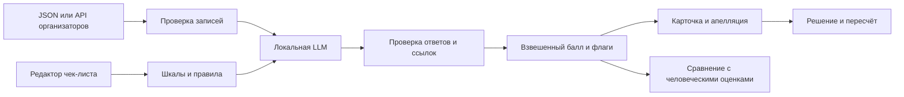

# Conversation Quality Analytics

Прототип для Freedom Broker Data Challenge. Загружает транскрипты RU, KZ и EN, проверяет работу оператора по редактируемому чек-листу, показывает основания оценки и сохраняет результат пересмотра. [Передача проекта и план работ](HANDOFF.md).

## Запуск

Для запуска приложения нужен Python 3.10+. У приложения нет зависимостей pip. Для новой оценки установите [Ollama](https://docs.ollama.com/windows), запустите его и выполните:

```powershell
ollama pull qwen3:4b
python app.py
```

Откройте http://127.0.0.1:8765. При входе откроется стартовый экран с интерактивным зелёным ASCII F и синим ASCII-логотипом Democrats. Кнопка со стрелкой открывает диалоги с анимацией на весь экран. При наведении символы ненадолго разлетаются и возвращаются. Три синтетических примера загружаются при первом запуске. Для оценки выберите диалог и нажмите **Оценить диалог**. Разверните критерий и нажмите на номер реплики, чтобы увидеть её в транскрипте и на полосе диалога. Вкладки «Диалоги», «Оценка» и «Чек-лист» разделяют список, проверку и настройки. На телефоне навигация находится внизу; переписка и оценка открываются по отдельности. При загрузке интерфейс плавно появляется. В самом нижнем слое фона плавает объёмный знак F, а вокруг него вращаются объёмные монеты без видимых орбитальных линий. Потяните свободную область для вращения орбит или нажмите для светового импульса и краткого ускорения. Утверждённая версия с коронной анимацией сохранена в ветке `checkpoint/blue-app-2026-11-08`. Для других локальных моделей укажите `CQA_MODEL` до запуска приложения. Модель должна поддерживать JSON-вывод по схеме. [Документация Ollama](https://docs.ollama.com/capabilities/structured-outputs).

### Просмотр на ноутбуке без модели

Для просмотра достаточно Python 3.10+ и браузера. Запустите `python app.py` и откройте http://127.0.0.1:8765. Загрузите исходные диалоги через **Загрузить диалоги**, затем внутренний файл оценки из `batch.py score` через **⋯ → Импорт оценок**. Оба файла должны относиться к одному запуску. Можно открыть доказательства, изменить чек-лист, подать апелляцию и пересчитать балл по решению проверяющего. Эти действия выполняются локально без вызова модели. **Оценить диалог** запускает новый анализ и требует подключённую модель.

Для командной работы участник с моделью запускает пакетную оценку и передаёт проверяющему два файла через согласованный канал. Файлы `results/dev/results.json` и `results/prod/results.json` предназначены для организатора. Для импорта в интерфейс используйте внутренний файл оценки, например `runs/control.json`.

### Запуск с llama.cpp

Скачайте [Qwen3-4B-GGUF](https://huggingface.co/Qwen/Qwen3-4B-GGUF) (Q4_K_M). Запустите локальный [llama-server](https://github.com/ggml-org/llama.cpp/tree/master/tools/server) с включённым шаблоном чата:

```powershell
llama-server -m qwen3-4b-q4_k_m.gguf --alias qwen3:4b --host 127.0.0.1 --port 8080 -c 16384 -np 1 --jinja
```

Во втором терминале:

```powershell
$env:CQA_PROVIDER = "llamacpp"
python app.py
```

`CQA_OLLAMA_URL` и `CQA_LLAMA_URL` задают адрес соответствующего локального сервера. `CQA_TIMEOUT_SECONDS` задаёт время ожидания ответа модели в секундах (по умолчанию 240). Для длинных звонков на медленном компьютере увеличьте лимит, например `$env:CQA_TIMEOUT_SECONDS = "420"`, и измерьте время прогона. На машине с GPU можно задать параметры выгрузки слоёв в `llama-server` отдельно.

## DEV и контрольный набор

Скопируйте ссылку **Открыть GET для DEV** со стр. 3 гайда в локальный файл `data/dev-url.txt`. Этот URL содержит подпись. Если организатор выдаст отдельную ссылку для контроля, используйте её. Обработка загруженного JSON тоже поддерживается.

```powershell
python batch.py fetch --url-file data/dev-url.txt --group DEV --output data/dev.json
python batch.py score data/dev.json --expect-count 65 --resume --output runs/dev.json
python batch.py export data/dev.json runs/dev.json --group dev --team-name "Democrats"
```

В браузере загрузите полученный JSON через **Загрузить диалоги**. Поддерживаются обёртка API, массив записей или один объект диалога. Звонки используют текст транскрипта. Ссылка на запись открывается из карточки.

Файл [results/dev/results.json](results/dev/results.json) содержит результаты текущего запуска для всех 65 диалогов. Экспорт создаёт JSON 1.0 по приложению к гайду, сохраняя исходные ID и номера реплик. В результаты входят восемь критериев, обоснования, итоговый балл и отдельный флаг грубой ошибки.

### Контрольный запуск

Подставьте выданный организатором `group_id` и используйте отдельно сохранённый файл ссылки, если организатор выдал новый адрес. Выполните блок из корня репозитория в терминале с настройками запущенной модели. Если организатор прислал готовый JSON, сохраните его как `data/control.json` и начните с команды `score`.

```powershell
if (-not $env:CQA_CONTROL_GROUP -or -not $env:CQA_MODEL_REVISION) {
    throw "Set CQA_CONTROL_GROUP and CQA_MODEL_REVISION before scoring."
}
python batch.py fetch --url-file data/control-url.txt --group $env:CQA_CONTROL_GROUP --output data/control.json
if ($LASTEXITCODE -ne 0) { throw "Control fetch failed." }
python batch.py score data/control.json --expect-count 10 --model-revision $env:CQA_MODEL_REVISION --resume --output runs/control.json
if ($LASTEXITCODE -ne 0) { throw "Control scoring failed. Check runs/control.json and retry with --resume." }
python batch.py export data/control.json runs/control.json --group prod --team-name "Democrats"
if ($LASTEXITCODE -ne 0) { throw "Control export failed." }
```

Установите `CQA_CONTROL_GROUP` и `CQA_MODEL_REVISION` в текущем терминале. Для локальных весов используйте SHA-256 модели. Программа проверит количество до первого вызова модели. При повторном запуске с `--resume` она сверит хеши набора и чек-листа, версию промпта и параметры модели. Затем она повторит только ошибки и оставшиеся диалоги. После экспорта проверьте `results/prod/results.json`. В нём должно быть ровно 10 исходных ID. Если обработка отдельного чата завершилась ошибкой, его запись имеет статус `error` и причину, как требует формат организатора. Для официальной выгрузки используется исходный чек-лист из восьми критериев.

Загрузите контрольные диалоги в интерфейс, затем выберите **⋯ → Импорт оценок** и внутренний файл `runs/control.json`. Приложение сверит хеши, границы ссылок и пересчитанные баллы перед показом. В разделе **О запуске** пакетная оценка подписана **Импорт из CLI**. Включите фильтр **Ошибки ИИ**, чтобы показать диалоги с флагом в последнем запуске. К оценке можно подать апелляцию и сохранить решение. Для проверки обработки новых данных запустите оценку прямо из карточки.

`data/dev-labels.json` должен содержать объект `{ "conversation_id": { "criterion_id": answer } }`, где на каждый диалог приходится полный набор ответов. Допустимы `"yes"`, `"no"`, `"na"` или числовая ступень конкретного критерия. `compare` показывает MAE итогового балла, точное совпадение по критериям и покрытие. `false_na` считает случаи, когда модель исключила применимый критерий. `missed_na` считает случаи, когда модель оценила неприменимый критерий. Это метрики команды. Официальная формула ранжирования не опубликована в полученных материалах.

Чтобы оценить набор после замены критерия на демонстрации, сохраните настройки в интерфейсе, скачайте чек-лист и передайте его через `--rubric` в `score` и `compare`. Используйте отдельный файл запуска для нового чек-листа. `score` обновляет выходной файл после каждого диалога. Неполный запуск содержит отдельный список ошибок и завершится с ненулевым кодом.

## Схема



Модель получает текущий чек-лист и пронумерованные реплики. Сервер проверяет ответы и диапазоны, затем рассчитывает итог и секции. При N/A веса перераспределяются пропорционально. Грубые ошибки выводятся отдельным флагом. Сохранённый запуск содержит исходную оценку и хеши входа и чек-листа. Для апелляции откройте критерий и **Оспорить оценку**, добавьте комментарий и затем сохраните решение проверяющего.

Настройки, загруженные данные и история хранятся в текущем браузере. Вкладка работает без регистрации. Код общий для команды через GitHub. Для параллельной работы создавайте ветку на задачу и открывайте pull request в `main`. Каталоги `data/` и `runs/` предназначены для локальных материалов.

## Проверка

```powershell
python -m unittest discover -s tests -v
node --check web/app.js
```

`node` нужен только для второй проверки. В [разделе калибровки](HANDOFF.md#consultation-calibration) есть результаты сравнения и команда для четырёх синтетических случаев. Перед сдачей выполните пять действий в интерфейсе: оцените новый диалог, откройте доказательство, покажите N/A, пересмотрите критерий и повторите оценку после изменения чек-листа.
